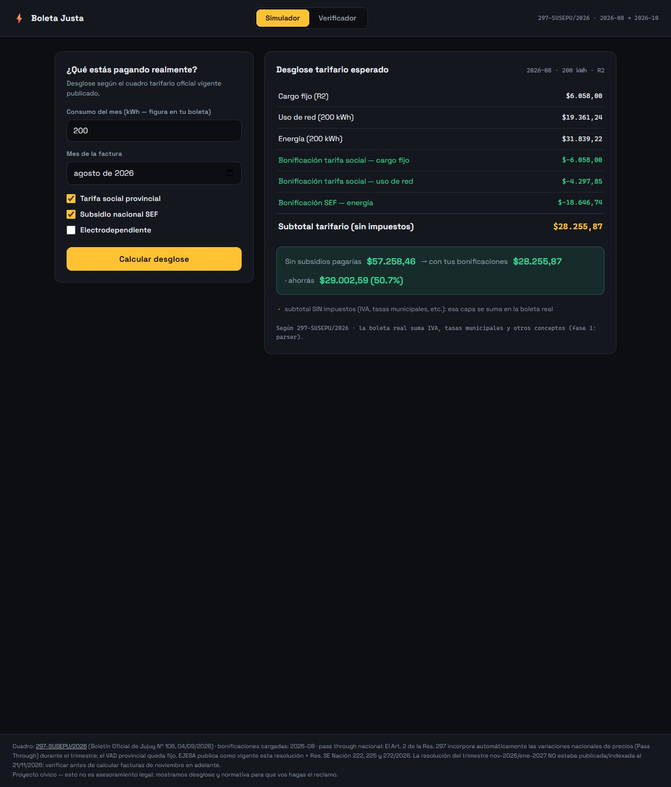

# Boleta Justa ⚡

Auditor ciudadano de facturas de EJESA (electricidad de Jujuy) + canal digital
de reclamos donde no hay oficinas físicas. Proyecto cívico hermano de
[cuando-llega-jujuy](https://github.com/MaxxyGuti3rr3z/cuando-llega-jujuy):
datos en manos de la gente, sin depender de la empresa.

**Problema**: facturas de $300.000-$600.000 en hogares vulnerables, impuestos
hasta 45% de la boleta, cortes que no respetan los 20 días de gracia del
decreto de emergencia, pueblos sin oficinas para reclamar, 11.000 firmas
vecinales juntadas. Ver `docs/marco-normativo.md` (todo con fuentes).

## Estado (21/11/2026)

- **Fase 0 HECHA**: marco normativo relevado de fuentes oficiales (Res.
  297-SUSEPU/2026 con cuadro T1 completo, tarifa social Res. 048/24, SEF
  Decreto 943/2025, Decreto Acuerdo 5658-JG/2026 de emergencia hasta 2027).
- **Calculadora tarifaria funcionando** (`src/tarifas.py`, stdlib pura):
  dado consumo kWh + mes + condiciones (tarifa social / SEF / electrodependiente)
  → desglose esperado: cargo fijo, uso de red, energía, bonificaciones por
  bloques, subtotal. Honesta: no inventa bonificaciones de meses no cargados
  y avisa cuando el mes está fuera de la vigencia del cuadro.
- **Verificador del decreto** (`src/decreto.py`): plazos objetivos del
  Decreto 5658 — corte (>20 días de mora de la 2ª factura impaga; el día
  exacto 20 se marca zona gris), retiro de medidor (≥60 días tras el corte),
  intereses punitorios (prohibidos en vigencia). Sin veredictos legales.
- **UI web local** (`src/api.py` + `web/`, FastAPI puerto 8101): landing page
  moderna (hero con desglose real de ejemplo, derechos del decreto con citas
  textuales, cómo funciona) que lleva al panel con dos herramientas: simulador
  "¿qué estás pagando realmente?" (formulario → desglose en dos columnas,
  comparación sin/con subsidios) y verificador de cortes/medidor/punitorios
  con badges y citas normativas. Identidad: ámbar eléctrico sobre carbón,
  Space Grotesk, números tabulares. Routing por hash (#panel).
- Tests: `py -3.13 pruebas/test_tarifas.py` y `pruebas/test_decreto.py`.





## Fases

- **Fase 1 (MVP)**: parser de boletas PDF (pdfplumber/PyMuPDF) + capa de
  impuestos modelada con boletas reales + UI web local: "¿qué estoy pagando
  realmente?" (consumo vs impuestos vs extras).
- **Fase 2**: OCR de fotos + simulador de tarifa social/SEF + detector de
  anomalías contra el cuadro vigente + generador de reclamo formal (SUSEPU/EJESA).
- **Fase 3**: registro de cortes vs plazos del decreto 5658 (20 días mora /
  60 días medidor / intereses punitorios prohibidos), estadísticas anónimas
  opt-in por barrio para los autoconvocados.

## Cómo correrlo

```
py -3.13 pruebas\test_tarifas.py                 # tests calculadora
py -3.13 pruebas\test_decreto.py                 # tests verificador
py -3.13 -m venv venv                            # primera vez
venv\Scripts\python.exe -m pip install -r requirements.txt
venv\Scripts\python.exe src\api.py               # http://127.0.0.1:8101
```

## Estructura

```
datos/tarifas/res297_2026-08.json   cuadro oficial estructurado (fuente BO Nº 106)
src/tarifas.py                      calculadora: categoría, componentes, bonificaciones
src/decreto.py                      verificador de plazos del Decreto 5658-JG/2026
src/api.py                          FastAPI: /api/cuadro /api/calcular /api/verificar/*
web/index.html                      UI: simulador + verificador (2 pestañas)
pruebas/test_tarifas.py             tests con valores esperados calculados a mano
pruebas/test_decreto.py             tests de plazos (19/20/21, 59/60, punitorios)
docs/marco-normativo.md             marco legal completo con fuentes y pendientes
docs/captura-*.png                  capturas de la UI
```

## Principios

- **Local-first**: la boleta no sale del dispositivo sin consentimiento.
- **Sin veredictos legales**: mostrar desglose + normativa; el reclamo formal
  lo presenta el usuario.
- **Datos versionados y fechados**: cada cuadro tarifario con su resolución y
  vigencia; las bonificaciones cambian mes a mes (pass through nacional).
- Privacidad: nada de datos personales en estadísticas agregadas (opt-in).

## Pendientes que dependen del usuario

1. **3-5 boletas reales** (PDF de Mi Cuenta EJESA o fotos) para diseñar el
   parser y modelar impuestos.
2. Verificar la resolución del trimestre nov-2026/ene-2027 (no publicada/indexada
   al 21/11/2026).

## Aliados

Vecinos autoconvocados por la emergencia tarifaria, centros vecinales,
defensorías, JujuyDev. Ver plan completo en
`C:\Users\hgmax\Desktop\proyectos-futuros\P2-boleta-justa.md`.
