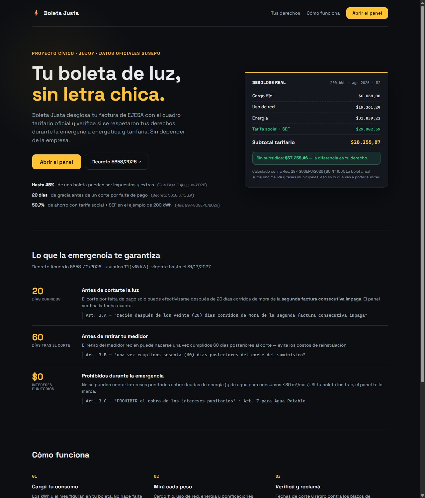
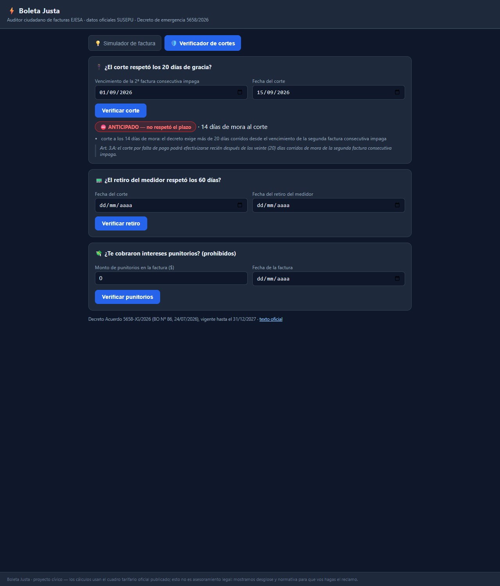
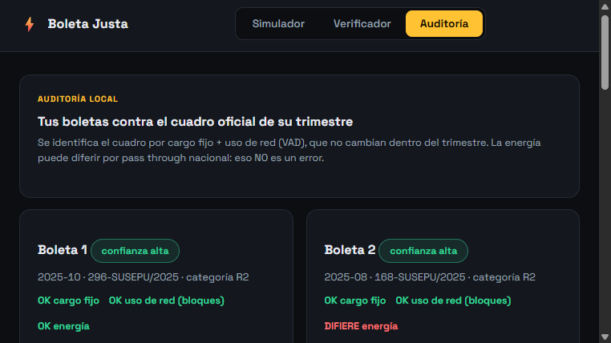
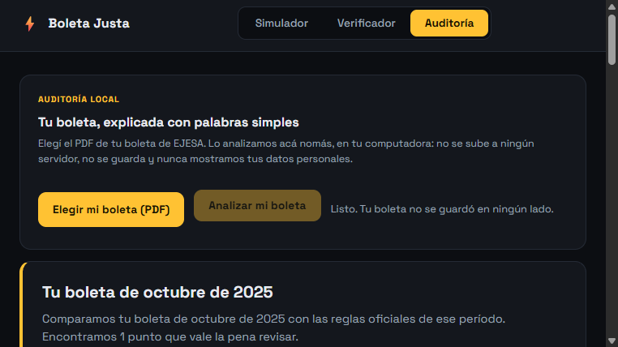

# Boleta Justa ⚡

[](https://github.com/MaxxyGuti3rr3z/boleta-justa/actions/workflows/tests.yml)

Auditor ciudadano de facturas de EJESA (electricidad de Jujuy) + canal digital
de reclamos donde no hay oficinas físicas. Proyecto cívico hermano de
[cuando-llega-jujuy](https://github.com/MaxxyGuti3rr3z/cuando-llega-jujuy):
datos en manos de la gente, sin depender de la empresa.

**Problema**: facturas de $300.000-$600.000 en hogares vulnerables, impuestos
hasta 45% de la boleta, cortes que no respetan los 20 días de gracia del
decreto de emergencia, pueblos sin oficinas para reclamar, 11.000 firmas
vecinales juntadas. Ver `docs/marco-normativo.md` (todo con fuentes).

## Estado (21/11/2026)

- **Fase 0 HECHA**: marco normativo relevado de fuentes oficiales (Res.
  297-SUSEPU/2026 con cuadro T1 completo, tarifa social Res. 048/24, SEF
  Decreto 943/2025, Decreto Acuerdo 5658-JG/2026 de emergencia hasta 2027).
- **Calculadora tarifaria funcionando** (`src/tarifas.py`, stdlib pura):
  dado consumo kWh + mes + condiciones (tarifa social / SEF / electrodependiente)
  → desglose esperado: cargo fijo, uso de red, energía, bonificaciones por
  bloques, subtotal. Honesta: no inventa bonificaciones de meses no cargados
  y avisa cuando el mes está fuera de la vigencia del cuadro.
- **Verificador del decreto** (`src/decreto.py`): plazos objetivos del
  Decreto 5658 — corte (>20 días de mora de la 2ª factura impaga; el día
  exacto 20 se marca zona gris), retiro de medidor (≥60 días tras el corte),
  intereses punitorios (prohibidos en vigencia). Sin veredictos legales.
- **UI web local** (`src/api.py` + `web/`, FastAPI puerto 8101): landing page
  moderna (hero con desglose real de ejemplo, derechos del decreto con citas
  textuales, cómo funciona) que lleva al panel con dos herramientas: simulador
  "¿qué estás pagando realmente?" (formulario → desglose en dos columnas,
  comparación sin/con subsidios) y verificador de cortes/medidor/punitorios
  con badges y citas normativas. Identidad: ámbar eléctrico sobre carbón,
  Space Grotesk, números tabulares. Routing por hash (#panel).
- **Fase 1 (EN CURSO)**: parser de boletas reales (`src/parser_boletas.py`,
  pypdf local) + auditoría (`src/auditoria.py`) contra 6 cuadros históricos
  oficiales cargados en `datos/tarifas/` (Res. 168/2025, 296/2025, 420/2025,
  81/2026, 227/2026, 297/2026). El cuadro se identifica por coincidencia de los
  componentes VAD (cargo fijo + uso de red, estables en el trimestre), NO por
  fecha de emisión: las 5 boletas calzaron con confianza alta y coincidencia
  exacta de VAD; la energía difiere 2-4% dentro del trimestre por pass
  through nacional (esperado). Uso de red resuelto: el precio impreso es el
  promedio ponderado por bloques de consumo (R1 0-150 kWh, R2 150-250,
  R2-bis 250-350...), NO el precio de una sola categoría. Verificado en 5/5
  con aritmética exacta p. ej. 150×69,2325 + 39,5×70,3651 = 13.164,30
  (Res. 296) y 150×65,0152 + 55×66,0788 = 13.386,62 (Res. 168). La bonificación
  TS está en el renglón propio, no descontada del precio unitario.
- **Subí tu boleta desde el panel**: pestaña "Auditoría" → "Elegir mi boleta (PDF)".
  El PDF se procesa en tu máquina (FastAPI local), se borra al terminar y la
  respuesta es una explicación en palabras simples, sin importes ni datos
  personales. Incluye frase por renglón, qué podés hacer y glosario.
  Endpoint `POST /api/auditar` (máx. 12 MB).
- **Panel con pestaña "Auditoría"**: 5 tarjetas con resolución elegida,
  confianza, chips OK/DIFIERE, notas de pass through y señales de punitorios.
  Endpoint `GET /api/auditoria` devuelve SOLO campos de comparación: nunca
  nombres, direcciones, DNI ni importes.
- **Cruce punitorios/decreto**: de 4 boletas con línea de interés punitorio,
  solo 1 (ago-2026) cae dentro de la vigencia del Decreto 5658 (desde el
  20/07/2026, Art. 3.C); las otras 3 son anteriores y NO se reclaman por esa
  norma. La UI lo distingue con "SEÑAL-VIGENTE" / "SEÑAL-fuera-vigencia".
  Inspección segura con `src/inspeccionar_boletas.py`: guarda el texto crudo
  solo en `boletas_reales/_texto/` y muestra por consola únicamente líneas de
  palabras clave con números enmascarados. Tests con texto SINTÉTICO
  (`pruebas/test_parser.py`): nunca se commitean boletas ni sus textos.
  Validado en 5 boletas reales (2025-10 a 2026-08): 100% de campos clave
  extraídos, consistencia aritmética verificada.
- **Pendiente de la fase 1**: cargar los cuadros tarifarios históricos (Res.
  105/227/297/2026 y resoluciones 2025) — las boletas son de otros trimestres
  y contra el cuadro de ago-2026 todas las comparaciones difieren (esperado).
- Tests: `py -3.13 pruebas/test_tarifas.py` y `pruebas/test_decreto.py`.
  `venv\Scripts\python.exe pruebas\test_parser.py`.







## Limpieza de datos sensibles

```bash
python scripts/limpiar_sensibles.py                       # dry-run: solo muestra
python scripts/limpiar_sensibles.py --apply               # borra derivados
python scripts/limpiar_sensibles.py --apply --include-originals  # borra TODO
```

Por defecto **no borra nada** y nunca toca los PDF originales: para eso hace
falta `--include-originals` explícitamente. Los derivados (`_texto/`,
`_parseado/`) se regeneran con `parser_boletas.py` y `auditoria.py`. El script
también chequea que no haya archivos sensibles trackeados por git (las capturas
de `docs/` son de la UI y no cuentan).

## Despliegue público (para que otras personas auditen sus boletas)

```bash
docker build -t boleta-justa .
docker run --rm -p 8101:8101 -e MODO_PUBLICO=1 boleta-justa
```

En modo público:
- se ocultan los 5 ejemplos del dueño y se desactiva `GET /api/auditoria`;
- el aviso de privacidad dice la verdad: **el PDF se envía al servidor**, se procesa
  y se borra sin guardarse ni compartirse (en local el aviso dice lo contrario);
- rate limit de 20 PDFs por minuto por IP y tope de 40 páginas;
- `$PORT` y `0.0.0.0` para plataformas (Render, Fly, Railway, etc.);
- `/api/health` para healthcheck; dependencias pineadas en `requirements.txt`.

Variables: `MODO_PUBLICO=1`, `PORT`, `MAX_PAGINAS_BOLETA`, `RATE_MAX`, `RATE_VENTANA`.
El `Dockerfile` **no copia** `boletas_reales/` (`.dockerignore`).

Antes de publicar: terminar TLS/HTTPS en el proxy, recordar que el rate limit es
en memoria por proceso (usar el del proxy si hay varios workers) y que la IP se
toma de `X-Forwarded-For`: si se expone sin proxy, limitar en el propio proxy.
Actualizar los cuadros tarifarios cada trimestre. Si querés privacidad estricta sin servidor,
la alternativa es parsear el PDF en el navegador (pdf.js/Pyodide).

## Fases

- **Fase 1 (MVP)**: parser de boletas PDF (pdfplumber/PyMuPDF) + capa de
  impuestos modelada con boletas reales + UI web local: "¿qué estoy pagando
  realmente?" (consumo vs impuestos vs extras).
- **Fase 2**: OCR de fotos + simulador de tarifa social/SEF + detector de
  anomalías contra el cuadro vigente + generador de reclamo formal (SUSEPU/EJESA).
- **Fase 3**: registro de cortes vs plazos del decreto 5658 (20 días mora /
  60 días medidor / intereses punitorios prohibidos), estadísticas anónimas
  opt-in por barrio para los autoconvocados.

## Cómo correrlo

```
py -3.13 pruebas\test_tarifas.py                 # tests calculadora
py -3.13 pruebas\test_decreto.py                 # tests verificador
py -3.13 -m venv venv                            # primera vez
venv\Scripts\python.exe -m pip install -r requirements.txt
venv\Scripts\python.exe src\api.py               # http://127.0.0.1:8101
```

## Estructura

```
datos/tarifas/res297_2026-08.json   cuadro oficial estructurado (fuente BO Nº 106)
src/tarifas.py                      calculadora: categoría, componentes, bonificaciones
src/inspeccionar_boletas.py   inspección segura (consola enmascarada, texto crudo local)
src/parser_boletas.py         parser PDF → JSON SOLO con campos tarifarios
pruebas/test_parser.py        tests con texto sintético (nunca boletas reales)
src/auditoria.py              selección de cuadro por VAD + comparación
src/explicar.py               resultado en lenguaje llano (frases, acciones, glosario)
scripts/limpiar_sensibles.py  borrado controlado de derivados y originales (dry-run default)
pruebas/test_auditoria.py     tests con boletas sintéticas (nunca datos reales)
pruebas/test_explicar.py      tests de redacción y privacidad
pruebas/test_deploy.py        tests de modo público y rate limit
pruebas/test_limpieza.py      tests de limpieza con fixtures sintéticas
src/api.py                    FastAPI: /api/cuadro /api/calcular /api/verificar/* /api/auditoria /api/auditar
web/index.html                      UI: simulador + verificador + auditoría (3 pestañas)
pruebas/test_tarifas.py             tests con valores esperados calculados a mano
pruebas/test_decreto.py             tests de plazos (19/20/21, 59/60, punitorios)
docs/marco-normativo.md             marco legal completo con fuentes y pendientes
docs/captura-*.png                  capturas de la UI
```

## Principios

- **Local-first**: la boleta no sale del dispositivo sin consentimiento.
- **Sin veredictos legales**: mostrar desglose + normativa; el reclamo formal
  lo presenta el usuario.
- **Datos versionados y fechados**: cada cuadro tarifario con su resolución y
  vigencia; las bonificaciones cambian mes a mes (pass through nacional).
- Privacidad: nada de datos personales en estadísticas agregadas (opt-in).

## Pendientes que dependen del usuario

1. **3-5 boletas reales** (PDF de Mi Cuenta EJESA o fotos) para diseñar el
   parser y modelar impuestos.
2. Verificar la resolución del trimestre nov-2026/ene-2027 (no publicada/indexada
   al 21/11/2026).

## Aliados

Vecinos autoconvocados por la emergencia tarifaria, centros vecinales,
defensorías, JujuyDev. Ver plan completo en
`C:\Users\hgmax\Desktop\proyectos-futuros\P2-boleta-justa.md`.
